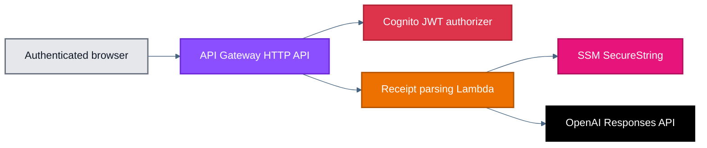

# Receipt Ingestion API Module

This module provisions a Cognito-protected HTTP API and Lambda function that accept receipt images, call the OpenAI Responses API, and return structured draft data that matches the app's existing receipt GraphQL inputs.

The OpenAI API key is intentionally not created here. The caller supplies only the SSM parameter name, and the Lambda reads that `SecureString` value at runtime.

## How It Works

1. `aws_apigatewayv2_api.this` creates an HTTP API with narrow CORS for the app origin.
2. `aws_apigatewayv2_authorizer.this` enforces Cognito JWT authentication before the Lambda runs.
3. `aws_lambda_function.this` validates the uploaded image, reads the OpenAI API key from SSM Parameter Store, calls GPT-6 Luna through OpenAI, and normalizes the JSON response.
4. `aws_lambda_permission.this` allows only this API Gateway to invoke the function.
5. The Lambda execution role can read only the configured SSM parameter and write logs to its log group, with 14-day retention. Receipt images, extracted drafts, and API keys are not logged.

## Architecture



## Example

```hcl
module "receipt-ingestion-api" {
  source                            = "../../modules/receipt-ingestion-api"
  application_name                  = "checksplit"
  cognito_user_pool_client_id       = module.cognito-auth.user_pool_client_id
  cognito_user_pool_id              = module.cognito-auth.user_pool_id
  environment                       = var.environment
  openai_api_key_ssm_parameter_name = "/checksplit/dev/openai/api-key"
  openai_model_id                   = "gpt-6-luna"
  receipt_parse_allowed_origins     = [
    "http://localhost:3000",
    "https://dev.example.com",
  ]
  receipt_parse_max_upload_bytes    = 4194304
}
```

## Inputs

| Name | Type | Description |
| --- | --- | --- |
| `application_name` | `string` | Application name used in resource naming. |
| `cognito_user_pool_client_id` | `string` | Cognito user pool client ID used as the JWT authorizer audience. |
| `cognito_user_pool_id` | `string` | Cognito user pool ID used to construct the JWT issuer URL. |
| `environment` | `string` | Deployment environment name. |
| `openai_api_key_ssm_parameter_name` | `string` | SSM SecureString parameter name that stores the OpenAI API key. |
| `openai_model_id` | `string` | OpenAI Responses API model ID used for receipt parsing. |
| `lambda_memory_size` | `number` | Memory size, in MB, for the receipt parsing Lambda. |
| `lambda_timeout_seconds` | `number` | Lambda timeout, in seconds, for receipt parsing requests. |
| `receipt_parse_allowed_origins` | `list(string)` | Browser origins allowed to call the receipt parsing HTTP API. |
| `receipt_parse_max_upload_bytes` | `number` | Maximum raw image upload size accepted by the API. |

## Outputs

| Name | Description |
| --- | --- |
| `openai_model_id` | OpenAI model ID configured for the receipt parsing Lambda. |
| `lambda_function_name` | Name of the receipt parsing Lambda function. |
| `parse_api_url` | Full receipt parsing HTTP API URL. |

## Notes

- This module intentionally does not create the OpenAI API key parameter.
- The Lambda source lives under `lambda/` and is expected to be built with `pnpm install --frozen-lockfile` and `pnpm run build` so `lambda/package` contains `dist/` plus runtime dependencies from `node_modules/`.
- The Terraform CI workflows build the Lambda package before running `terraform plan` or `terraform apply`.
- The API does not expose a Lambda Function URL.

## Luna configuration and rollout

The default model is `gpt-6-luna`, using the [OpenAI Responses API](https://developers.openai.com/api/docs/guides/structured-outputs?api-mode=responses) with strict JSON schema output, high-detail image input, `reasoning.effort: none`, standard service tier, and `store: false`. Prompts and the receipt draft schema are unchanged. Requests have a 20-second deadline and no retries. Production allows up to 8,192 output tokens to accommodate longer receipts; the independent five-receipt evaluator retains its smaller 1,600-token smoke budget. Incomplete responses, refusals, and invalid drafts fail without saving a receipt.

The UI accepts both `openai-responses-api` and legacy `gemini-developer-api` metadata. Publish that UI compatibility change before switching the Lambda, including when using the combined staging/production workflows (which currently deploy infrastructure first). Keep the prior Gemini parameter available for rollback.

On October 24, 2026, a live smoke check through the packaged Lambda returned valid drafts for all five public evaluator images. Four passed every extraction and derived arithmetic check. Receipt `1085` read the first item as quantity 1 at $180.00 instead of quantity 20 at $9.00; line and receipt totals still matched, and the draft required review. These five images do not establish a production quality gate.

Before applying infrastructure in each environment:

1. Provision the OpenAI API key as an SSM **SecureString** at `/checksplit/<environment>/openai/api-key`, or set `openai_api_key_ssm_parameter_name` to an existing SecureString. Keys in the evaluator's local `.env` are not uploaded automatically.
2. Allow the Terraform caller, including its GitHub Actions role, `ssm:GetParameter` on that parameter. Bootstrap configures this for Dev through the `github-actions-auth` module's optional `receipt_parse_api_key_ssm_parameter_name` input; set the input for other environments when migrating them, then apply bootstrap. Terraform looks up the ARN with `with_decryption = false`; only the Lambda decrypts the key at runtime. Use the default SSM encryption key, or separately grant the Lambda `kms:Decrypt` when using a customer-managed KMS key.
3. Replace `gemini_api_key_ssm_parameter_name` and `gemini_model_id` overrides in environment tfvars or GitHub `TFVARS` secrets with `openai_api_key_ssm_parameter_name` and `openai_model_id` (default `gpt-6-luna`). The model output is now `receipt_parse_openai_model_id`.
4. Build the Lambda package, review the Terraform plan, then deploy and verify an authenticated image upload returns `parser.provider = "openai-responses-api"` and `parser.modelId = "gpt-6-luna"`.

Run handler checks without credentials or model calls:

```bash
cd infra/modules/receipt-ingestion-api/lambda
pnpm install --frozen-lockfile
pnpm test
pnpm run typecheck
pnpm run build
```
